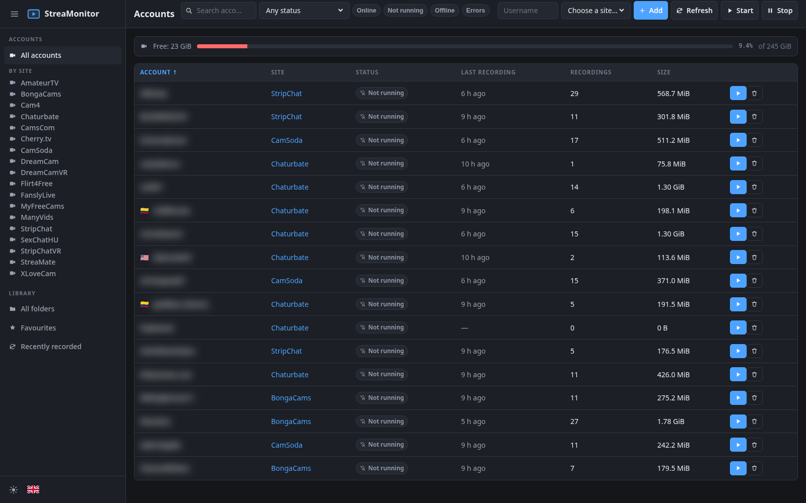
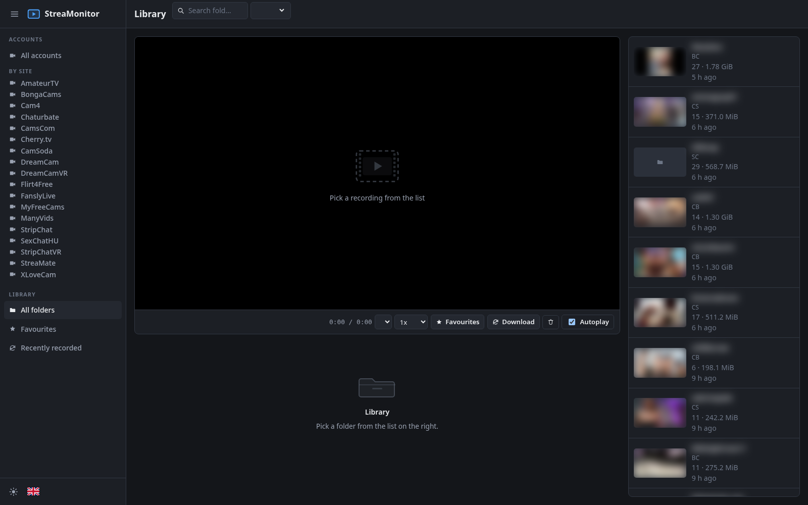
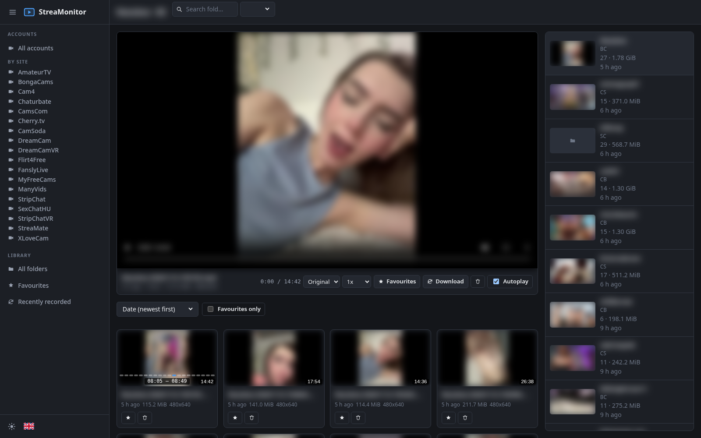
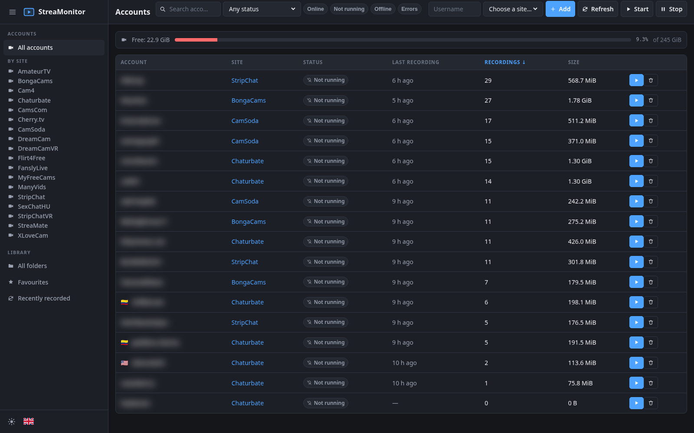
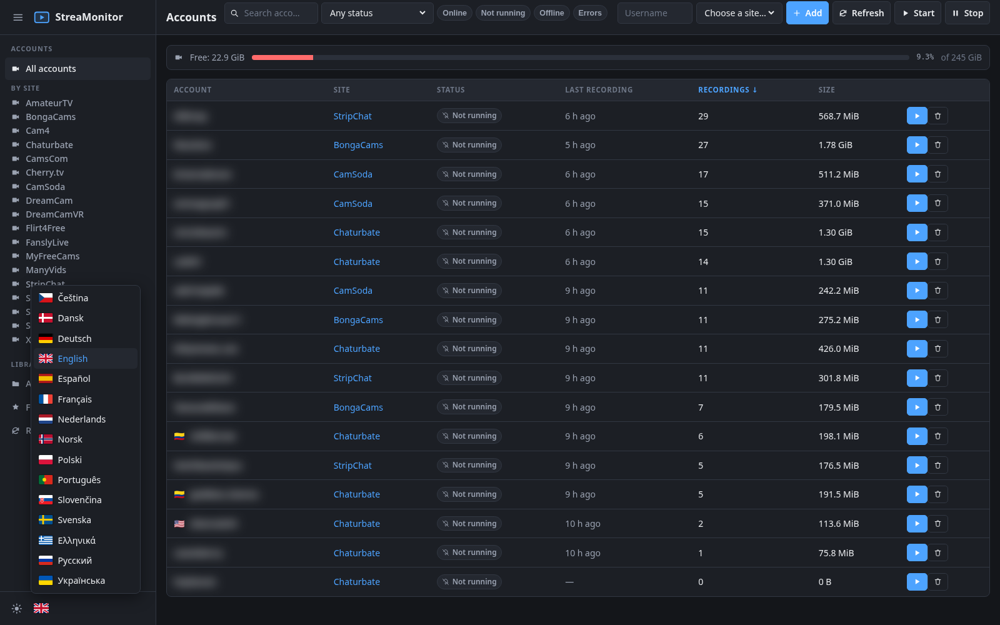
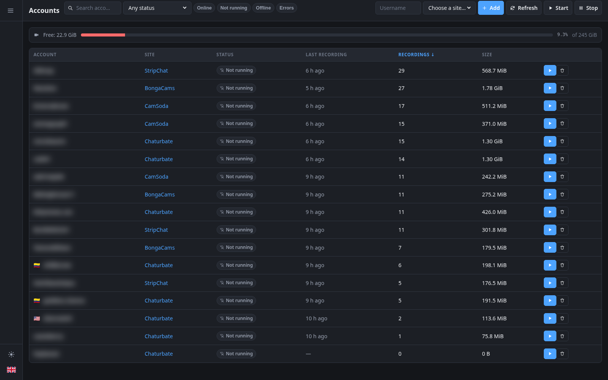
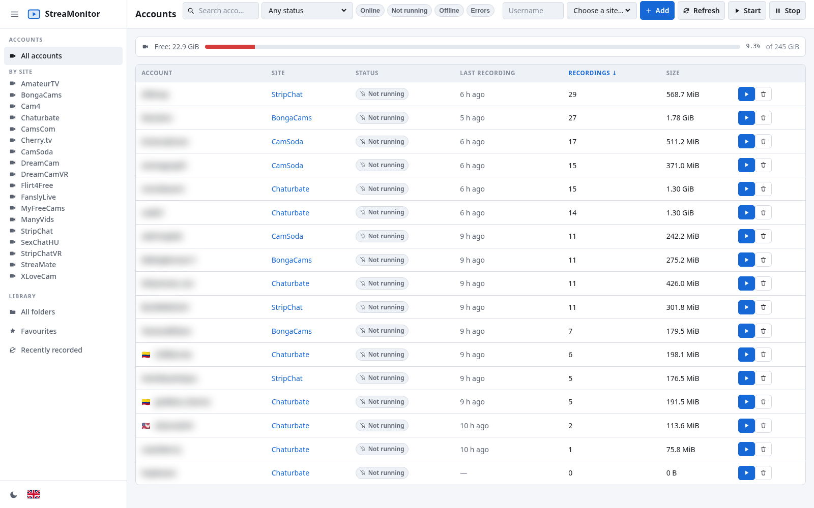
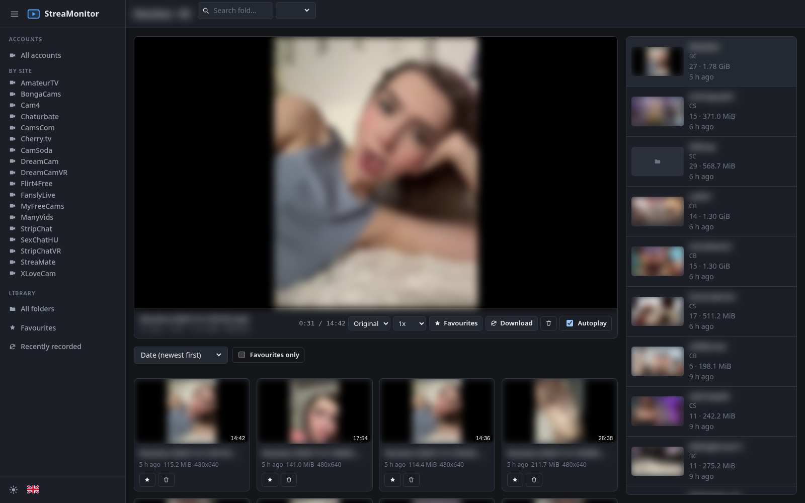

# StreaMonitorV2

A recording manager for live cam sites with a reworked web interface,
a metadata index and a media pipeline. Based on the fork of
`lossless1024/StreaMonitor` (via `Wado729/StreaMonitor`); this repository
carries the interface and the pipeline work on top of it.

Author: awerskto (awerskto@users.noreply.github.com)

---

## Screenshots

The private data is blurred in every screenshot: the thumbnails, the
account names, the folder names and the titles of the recordings.

| | |
|---|---|
|  |  |
| Accounts: filters, chips, bulk actions and the add form in one top bar row. Sortable columns. | Library: the folder list on the right shows the poster of the newest recording. |
|  |  |
| The player with the scrub storyboard: moving the pointer through the lower part of a thumbnail skims the recording. | The columns sort by a click on the header. |
|  |  |
| Fifteen languages with drawn flags, next to the dark mode switch. | The collapsed sidebar stacks the two footer buttons. |
|  |  |
| The same interface in the light theme. | The player: original or 360p proxy, download, favourites, delete with confirmation. |

---

## What changed against the base project

### The interface

- **One skin, one API.** The three htmx skins (truck-kun, shaftoverflow,
  kseen715) and their endpoints (`/api/data`, `/api/command`,
  `/api/basesettings`) are gone; everything runs through the JSON API under
  `/api/v2/*` and the SPA skin `tube` — vanilla JavaScript (ES modules), no
  build step, no Node in production. That removed ~24 000 lines.
- **Scrub storyboard.** The animated hover preview is replaced by a sprite
  with twenty frames, one every 5% of the recording, arranged in a 5x4 grid.
  Moving the pointer through the lower part of a thumbnail skims the
  recording; a portrait video keeps its proportions, a landscape one fills
  the card. One file, one request, served with an ETag.
- **Media pipeline.** After a recording finishes a poster and the storyboard
  are built (hardware acceleration when available, silent CPU fallback,
  retry, atomic rename, `*.part`), and the metadata lands in SQLite under
  `DOWNLOADS_DIR/.cache/`: duration, resolution, the display size from the
  rotation and the pixel aspect ratio. Recordings made before the pipeline
  existed are picked up on startup.
- **Vertical videos.** A recording from a phone is displayed upright: the
  rotation and the sample aspect ratio are read from the metadata, the
  thumbnails and the storyboard keep the real proportions, nothing is
  cropped or stretched.
- **Interface graphics.** A logo, illustrations for the empty states
  (no folders, no recordings, no favourites), a film strip placeholder for a
  card without a poster, and drawn flags for the languages. All inline SVG,
  so they follow the dark and the light theme and stay crisp.
- **Fifteen languages.** The browser language is used when nothing was
  chosen, English is the fallback; the choice is stored and the switcher
  with the drawn flags sits next to the dark mode switch.
- **Sortable columns** in the account list (click the header, click again to
  reverse), and the two statuses the list shows most — "Not running" and
  "Offline for a long time" — are in the status filter now.
- **A tidy top bar.** The filters, the chips, the bulk actions and the add
  form share one row next to the title; the collapsed sidebar stacks the two
  footer buttons inside the narrow column.

### The recording quality

- **A/V desync on Chaturbate fixed.** The master playlist declares several
  audio groups and ffmpeg opened all of them; together with an expiring
  session token in the chunklist URLs this desynchronised the renditions.
  One audio rendition is used and the playlist is refreshed while the
  recording runs. Measured: ~0.02 s of drift after six minutes.

### Robustness

- **The pipeline runs in the live application.** `main()` returned
  immediately, the interpreter entered its shutdown phase and
  `concurrent.futures` stopped accepting work: the media pipeline never
  produced a thumbnail in the running application, while every unit test
  was green. The main thread now waits for the shutdown event.
- **Self healing.** A hook that fails (no codec, no space, a timeout) left
  the recording without a thumbnail forever; the sweep requeues the missing
  artifacts. The backfill is limited and does not run the user command of
  `STRMNTR_POST_RECORD_CMD` over the whole history.
- **Low disk.** The out of space detector stops the recordings instead of
  closing the whole application, and the proxy skips its work below the
  free space threshold.
- **The gender survived a restart.** It was saved to `config.json` as a
  number and not converted back into the enum, which made the accounts API
  answer with HTTP 500 after every restart.
- **Fresh assets.** The stylesheets and the JavaScript modules are
  revalidated on every load; the browser previously kept an old module after
  an update, which made the interface look broken.

### Security

- **CSRF.** A page on another origin could start a streamer with the cached
  basic authentication. Every request that changes something has to carry
  the `X-Requested-With` header of the application and, when the browser
  sends an `Origin`, it has to be the origin of the request.
- **Deletion narrowed.** `DELETE` of a recording accepted any file inside
  the downloads folder, including the database. It is a video file now, the
  cache of the application is refused, and a recording that is still being
  written is refused with 409.
- **Path handling.** Every path that comes from the client goes through
  `safe_join`.

### Performance

- The video list counts and pages in SQL (`LIMIT`/`OFFSET`) instead of
  loading the whole folder and slicing it in Python.
- The account list reads the statistics of every account with one
  `GROUP BY` instead of one query per account.
- The payload of a folder is built only for the page the client asked for.

### Tests

138 pytest tests, among them headless Chromium browser tests of the
accounts view, the library, the scrub storyboard and the language switcher,
plus regression tests for the incidents above.

---

## Running

```bash
python3 -m venv .venv
.venv/bin/pip install -r requirements.txt
.venv/bin/python Downloader.py
```

The web interface listens on port 5000 (configurable with
`STRMNTR_PORT`), user `admin`, password from `STRMNTR_PASSWORD`.
The tests need the development requirements:

```bash
.venv/bin/pip install -r requirements-dev.txt
.venv/bin/python -m pytest tests/
```

See `WIEDZA.md` for the diagnosis of the A/V desync and the pitfalls met on
the way (in Polish).

## Licence

Same as the base project (see `LICENSE`).
